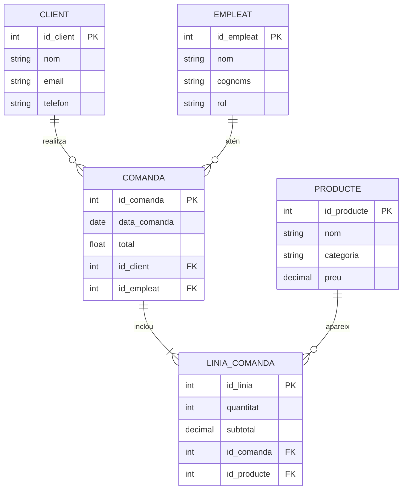

# Diagrama ER - Mermaid

A continuació tens un exemple bàsic de diagrama ER en Mermaid que pots adaptar a l'activitat.

Aquest model representa una relació típica entre clients, empleats, comandes i productes.
